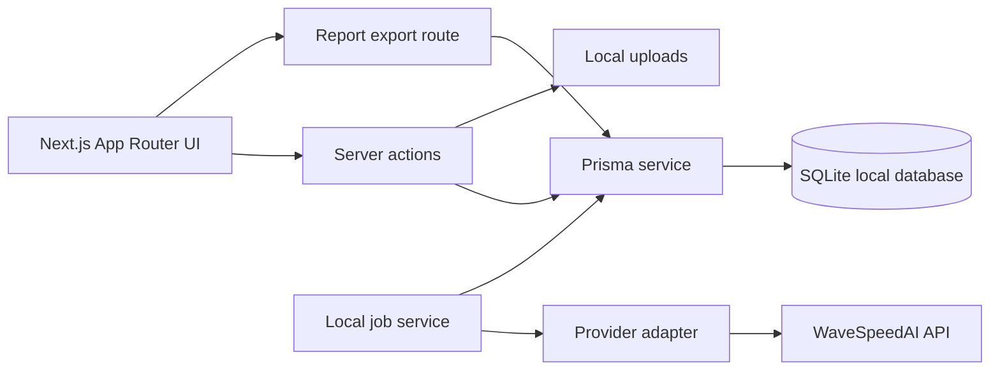

# Architecture

The modular monolith uses Next.js, TypeScript, Prisma, SQLite, Zod, Tailwind, Vitest, and Playwright. Prisma relations and scalar fields are portable to PostgreSQL. SQLite and uploads are local-only; no accounts or public report routes exist.

`Model` records identity/version; `ProviderConfig` records a provider-specific model ID, parameters, estimated price, and capabilities. A `Suite` has reusable `TestCase` prompts and optional references. A `Comparison` binds a suite and two models with decision thresholds. `Output` stores each imported generation, its prompt and settings snapshot, optional latency/cost, provider, and local image path. `Rating` holds randomized left/right IDs, preference, category scores, notes, provenance, and timestamp. `Job` stores persistent state, attempts, timeout, idempotency key, and external task ID.

The blind UI randomizes each pair at render time and excludes rated pairs. Identities are hidden until ratings are submitted. Human reviewers score identity, quality, and adherence separately. No automated judge or pixel similarity is used.

The report computes challenger wins among decisive ratings and arithmetic means over known numeric values. The rule recommends switching only after a configured minimum number of decisive pairs, sufficient challenger win rate, and an acceptable cost ratio when both costs are known. Otherwise it retains the baseline; insufficient pairs yield “Collect more evidence.” This is a heuristic, not a statistical confidence claim. Manual import cannot measure failure rate because failed attempts are not observed.

`ProviderAdapter` defines validation, submit, poll, and optional cancellation. The WaveSpeed adapter uses the documented model POST and prediction result GET routes. `runJob` persists transitions and retries polling errors only; a failed or ambiguous billable POST is never automatically retried. Integrations for RunPod/ComfyUI, BytePlus, fal.ai, Replicate, and custom HTTP can implement the same contract. Each must validate its own request parameters and normalize results. The hosted runner is not scheduled or exposed in the UI yet.
